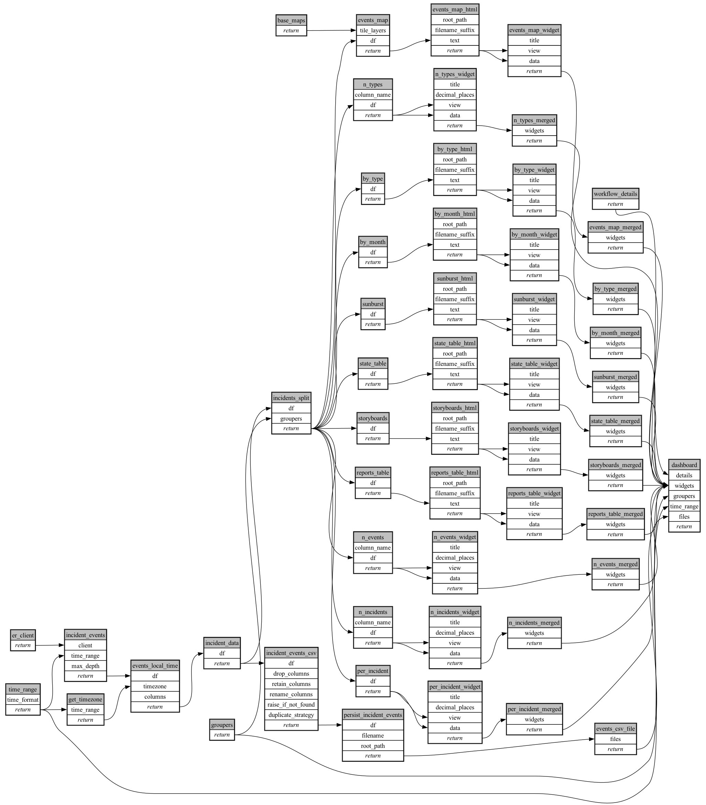

```
# AUTOGENERATED BY ECOSCOPE-WORKFLOWS; see fingerprint in README.md for details

```

```yaml
# fingerprint:
artifacts_sha256_basic: f42b7e0549bcf33b2123730c3bafa6d29d7e09aae06b4242e0e6c396a8f43097
artifacts_sha256_strict: e48b39f4ace990ad7d1264066ec69be5db1cd0e49193821b741e12188454251e
installed_requirements:
- channel: https://repo.prefix.dev/ecoscope-workflows/
  name: ecoscope-platform
  version: {version: ==2.39.4}
- channel: conda-forge
  name: pydeck
  version: {version: ==0.9.2}
- channel: https://repo.prefix.dev/ecoscope-workflows-custom/
  name: ecoscope-workflows-ext-wd
  version: {version: ==0.0.19}
params_sha256: 0c66765d8fbcff81d2829db7e247cab906ff83689aa3c46a36bf612e10af7f32
spec_sha256: d4e91399e90838849d7e6b0066b3fd63d4a3021fc84447a2ac26587edd483958

```

# ecoscope-workflows-incident-reports-workflow


