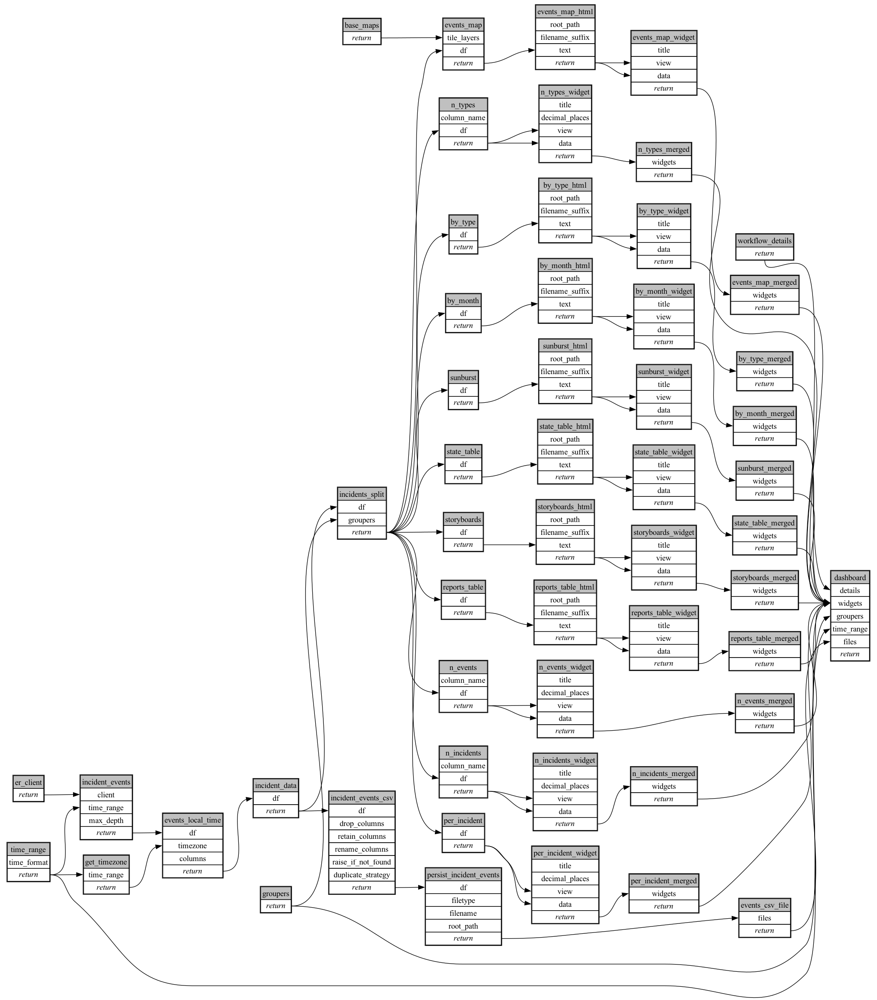

```
# AUTOGENERATED BY ECOSCOPE-WORKFLOWS; see fingerprint in README.md for details

```

```yaml
# fingerprint:
artifacts_sha256_basic: 285e2baf55b2c45ddb8c0175d0f1d6365fefdfd18af56c1e339c2a4f0cb1c777
artifacts_sha256_strict: 40c1f358d2d24a3960a514520a3cbfa762f5779f65b729deababe5eab38a3ae4
installed_requirements:
- channel: https://repo.prefix.dev/ecoscope-workflows/
  name: ecoscope-platform
  version: {version: ==2.28.0}
- channel: https://repo.prefix.dev/ecoscope-workflows-custom/
  name: ecoscope-workflows-ext-custom
  version: {version: ==0.1.2}
- channel: conda-forge
  name: pydeck
  version: {version: ==0.9.2}
- channel: https://repo.prefix.dev/ecoscope-workflows-custom/
  name: ecoscope-workflows-ext-wd
  version: {version: ==0.0.14}
params_sha256: 3d9b45d7b4659d2e832349327938e10216b60ef3bd967c6c291c8b48886c9181
spec_sha256: 2f55fbef0ac82718c5a0e36198c5956fedab4674f41750763cd63213d6f208ab

```

# ecoscope-workflows-incident-reports-workflow


