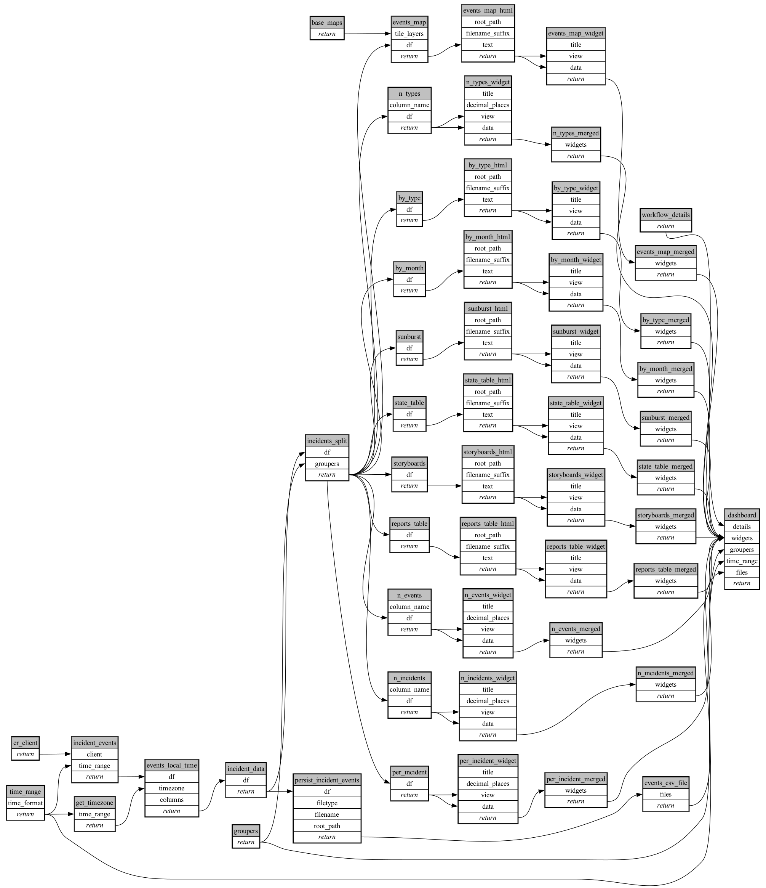

```
# AUTOGENERATED BY ECOSCOPE-WORKFLOWS; see fingerprint in README.md for details

```

```yaml
# fingerprint:
artifacts_sha256_basic: 5b60697df564874e12ed6700aca80d6ff27975edc788055fa422eea8227f79c9
artifacts_sha256_strict: 46aefbcfb7dead938a6667fc3edf8987e1ac1419cc35afb234a024f25b44af9f
installed_requirements:
- channel: https://repo.prefix.dev/ecoscope-workflows/
  name: ecoscope-platform
  version: {version: ==2.26.0}
- channel: https://repo.prefix.dev/ecoscope-workflows-custom/
  name: ecoscope-workflows-ext-custom
  version: {version: ==0.1.2}
- channel: conda-forge
  name: pydeck
  version: {version: ==0.9.2}
- channel: https://repo.prefix.dev/ecoscope-workflows-custom/
  name: ecoscope-workflows-ext-wd
  version: {version: ==0.0.8}
params_sha256: b3a1879fc6d339a1c507718b7aab91ec15ab99fcac1ff65e513655766542a334
spec_sha256: 9802e29b0adfc70b7c6540d22511388718f8ffc26bb5dbbc9f2feeb621647bd4

```

# ecoscope-workflows-incident-reports-workflow


